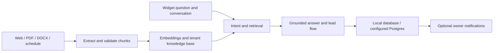

# Dunn Consulting — AI Front Desk

A multi-tenant AI assistant that answers business questions from a knowledge base, collects leads, and supports front-desk follow-up workflows. Built by **Randal Dunn** as part of Dunn Consulting.

[Website source](https://github.com/RONJ0N/dunn-consulting-portfolio) · [Dunn Consulting](https://www.dunnconsulting.org/) · [LinkedIn](https://www.linkedin.com/in/randal-dunn-4342b3379/)

## What this demonstrates

- **RAG:** document extraction, structured chunking, embeddings, semantic retrieval, keyword boosting, intent-aware context selection, and confidence filtering.
- **AI integration:** OpenAI chat and embedding APIs, conversation-aware prompts, structured outputs, and evaluation scripts.
- **Backend engineering:** Next.js API routes, TypeScript, Drizzle, SQLite, and PostgreSQL/pgvector.
- **Tenant boundaries:** tenant-aware repositories, PostgreSQL RLS migrations, separate database roles, signed sessions, and embed-token validation.
- **Workflow integration:** lead capture, configurable email/SMS notifications, missed-call handlers, webhook verification, and scheduled follow-up code.

This source showcase includes demo knowledge bases and placeholder contact destinations. It excludes private tenant exports, personal contact information, business planning, deployment schedules, and private Git history. It is not connected to the production service. No customer, revenue, accuracy, or production-security claim is implied by the sample data.

## Architecture



## Run locally

Use Node.js 22 or 24 and npm. SQLite initializes a local database; no production database is required.

```bash
npm ci
cp .env.example .env
npm run dev
```

Open [localhost:3000](http://localhost:3000) for the demo page. The local admin password defaults to `demo-admin` when unset. **That fallback is rejected in production.**

For AI responses, add your own `OPENAI_API_KEY` to `.env` and create embeddings for the demo knowledge base:

```bash
npm run seed -- demo-gym
```

Other included sample tenant IDs are `dunn-consulting` and `summit-home-services`. They use placeholder contact destinations; their sample facts and offers are not current business commitments. Generate embeddings separately for any tenant you choose to run. Embedding, ingestion, chat, and model evaluation commands call paid APIs only when run with your own credentials.

Email/SMS credentials are blank, tenant automation is disabled, and production cron schedules are omitted. Keep it that way for a local portfolio walkthrough. Never enter real customer or applicant information into the demo.

## Code map

| Area | Source |
| --- | --- |
| Chat orchestration | `app/api/chat/route.ts`, `lib/chat/` |
| Retrieval and ranking | `lib/rag/search.ts`, `lib/rag/query-builder.ts` |
| Ingestion and structured chunking | `lib/ingest/`, `scripts/ingest.ts` |
| Tenant and database boundaries | `lib/gym/`, `lib/db/`, `drizzle/postgres/` |
| Widget and admin UI | `components/`, `app/widget/`, `app/admin/` |
| Deterministic tests | `tests/` |
| Model-dependent evaluations | `scripts/eval-*.ts` |

## Checks

```bash
npm test
npm run typecheck
npm run lint
npm run build
```

Unit tests do not require live provider credentials. AI evaluation scripts require credentials and are separate from the deterministic test suite. Test/build results do not verify a deployed database, carrier integration, or external provider.

## Deployment boundary

This is source for inspection and a local demo, not a turnkey production deployment. Before operating it with real users, configure independent strong admin/session/cron secrets, tenant access controls, signed embeds/webhooks, durable storage, rate limiting, and provider credentials. Production PostgreSQL requires a separate restricted `APP_DATABASE_URL`; the owner connection is for administrative operations. Migrations still need to be applied and verified on your own database. The root production route intentionally does not show the local demo.

## Verified for this source release

On 2026-10-08: lint, TypeScript checking, and the production build passed. The deterministic suite passed 74 tests in 14 files, including production credential checks. Live model evaluations and external provider delivery were not run.

The source release passed a credential scan. That scan does not certify future edits or a deployed service.

## Rights and dependencies

Published for portfolio review. No general open-source reuse license has been granted for original application code or Dunn Consulting branding. Dependency licenses remain in force. Bundled Geist fonts are distributed under the [SIL Open Font License](app/fonts/OFL.txt); upstream: [vercel/geist-font](https://github.com/vercel/geist-font).
